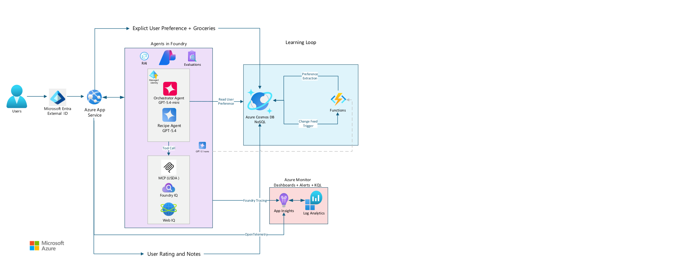

# ai-sous-chef

The [feedback Functions host](docs/feedback-host.md) is deployed independently
from the web app using the reviewed dev workflow. This infrastructure slice adds
host health and keyless connections only, not feedback processing or learning.

AI Sous Chef combines current groceries, grounded recipe generation, and
feedback-based personalization.

## Local backend

The scaffold runs a FastAPI backend with offline readiness doubles and fail-closed
consumer authentication. Profile/onboarding, grocery inventory and conversation
persistence APIs, shared Cosmos access and the managed-agent gateway are available.
The React frontend adds the authenticated three-tab shell and onboarding/profile
editing. Grocery, chat and recipe-history screen contents remain follow-on work.
Live chat execution and other product endpoints remain separate work.
The [Recipe + Nutrition specialist](docs/recipe-specialist.md) supplies versioned
instructions, strict recipe output and fixture-backed grounding/nutrition interfaces;
live tool wiring and final recipe approval remain separate work.
See [frontend setup and scope](docs/frontend.md).
See [profile API setup and usage](docs/profiles.md) and
[conversation setup and HTTP contracts](docs/conversations.md) for the persistence APIs.
See [consumer sign-in setup](docs/authentication.md) for the
Google/GitHub/single-tenant Microsoft App Service sign-in, the original External
ID option, owner setup and signed-token local testing.
See [grocery inventory APIs](docs/groceries.md) for adding, editing and removing
owned groceries without AI calls.
See [bounded request context](docs/conversations.md#bounded-request-context-asc-23--24)
for current-profile refresh, conversation selection, token budgets and learned-input wiring.

Use **Ubuntu 24.04 in WSL 2**, CPython **3.12**, and a checkout in the Linux
filesystem. Windows supplies the editor and browser. Do not share a virtual
environment or `node_modules` between Windows and Linux.

Run these setup commands inside Ubuntu:

```bash
sudo apt-get update
sudo apt-get install -y python3.12-venv git
mkdir -p ~/repos
cd ~/repos
git clone https://github.com/AgamMakkar21/ai-sous-chef.git
cd ai-sous-chef
git switch dev
python3.12 -m venv .venv
source .venv/bin/activate
python -m pip install -r requirements-dev.txt
python -m pip install --no-build-isolation --no-deps -e .
cp .env.local.example .env.local
export ASC_ENVIRONMENT=local
python -m uvicorn sous_chef.app:create_app --factory --host 0.0.0.0 --port 8000 --reload --no-access-log
```

GitHub authentication is required for a private checkout; use your approved
Git credential helper, never a token embedded in the clone URL.
Binding to `0.0.0.0` supports Windows-to-WSL localhost forwarding; use only on
a trusted development machine. Stop the server with Ctrl+C.

Open <http://localhost:8000/health> in the Windows browser. It returns exactly
`{"status":"ok"}`. <http://localhost:8000/ready> returns `{"status":"ready"}` in
explicit local-double mode. Local API documentation is at
<http://localhost:8000/docs>. Protected routes, including the root URL, return 401
without authentication. After authentication the root serves the frontend when
its build is installed; otherwise it returns a truthful 503. Local readiness
doubles do not supply a browser login or fake profiles.

In another Ubuntu terminal, verify the scaffold:

```bash
cd ~/repos/ai-sous-chef
source .venv/bin/activate
python -m ruff format --check .
python -m ruff check .
python -m mypy
python -m pytest
```

Tests use offline probes and generated frontend fixtures; no Azure account or
credentials are needed. Populate the public
[tokenizer cache](docs/conversations.md#budget-and-tokenizer-setup) during setup
before running context tests offline.

## Pull request quality checks

PRs targeting `dev` or `main` run formatting/lint, strict type checking,
unit/API contract tests, installed-wheel smoke checks, and offline infrastructure
tests, plus frontend lint/types and desktop/phone browser checks.
See [CI setup and required-check wiring](docs/ci.md) for exact check names,
local commands, safety boundaries, and the administrator's enforcement checklist.
This workflow validates code only; it does not deploy to Azure.

Reviewed merges into `dev` have a separate, dev-only OIDC deployment workflow.
See [dev delivery setup](docs/dev-delivery.md) for owner bootstrap, scoped roles,
versioned agent release pins, smoke checks and recovery.

## Configuration and readiness

Set `ASC_ENVIRONMENT` in the process environment to `local`, `dev`, or `prod`.
The app reads only `.env.<environment>` in the working directory, not a generic
`.env`. Process variables override that file. Startup rejects missing or invalid
settings with field names and setup guidance, never the rejected values.

| Setting | Purpose |
| --- | --- |
| `ASC_ENVIRONMENT` | Required explicit environment selection |
| `ASC_ADAPTER_MODE` | Required `local` or `live`; local doubles are forbidden in dev/prod |
| `ASC_AGENTS_ENABLED` | Default `true`; staged dev delivery sets `false` to disable managed agents until their tools are ready |
| `ASC_READINESS_TIMEOUT_SECONDS` | Positive finite readiness deadline, at most 10 seconds; default 2 |
| `ASC_STATIC_DIR` | Optional frontend build directory; default `backend/src/sous_chef/static` |
| `ASC_COSMOS_ENDPOINT` | Required in live mode; HTTPS URL without credentials or query parameters |
| `ASC_COSMOS_DATABASE` | Required nonempty database name in live mode |
| `ASC_PAGINATION_KEY` | Protected Fernet key required for conversation APIs; see [setup](docs/conversations.md) |
| `ASC_FOUNDRY_PROJECT_ENDPOINT` | Required in live mode when agents are enabled; HTTPS URL without credentials or query parameters |

`.env.local.example`, `.env.dev.example` and `.env.prod.example` contain no live
endpoints or secrets. Empty live values must be supplied by deployment configuration.
Actual `.env` files are ignored by Git. Do not add cloud service keys: hosted integrations
must use managed identity, and each interactive agent must retain a distinct
Entra Agent identity when those integrations are implemented.

`GET /health` checks only the web process. `GET /ready` uses a bounded, injectable
dependency probe. An unavailable dependency or timeout returns a generic 503
`application/problem+json` response; unexpected errors return a generic 500.
Errors include an opaque `traceId`. Logs do not include exception contents,
settings, endpoints or user data. API docs are disabled outside local mode.

Live readiness reads Cosmos container metadata and, when agents are enabled,
both configured, explicitly pinned Foundry agent versions with the workload identity. It verifies separate,
enabled agent identities without reading user documents or invoking models/tools.
Missing agent pins in an agent-enabled release, workload principal ID or
authentication configuration remain **not ready**. An explicitly app-only dev
release skips Foundry agent metadata and refuses managed-agent execution; it does
not skip Cosmos/authentication checks or return fake AI results. The same
[reviewed workflow](docs/dev-delivery.md#release-stages) enables pinned agent
releases later. Valid configuration alone is not proof of connectivity. Automated
dev packages also report their source commit in `X-ASC-Commit` on successful
health/readiness responses; the JSON bodies are unchanged.

## Privacy-safe MVP logging

Every HTTP request receives a server-generated random `X-Trace-ID`, also used as
`traceId` in problem responses. Incoming IDs are not trusted or echoed. Completion
and failure logs are JSON with only `event`, `trace_id`, HTTP `status`,
`duration_ms` and, for failures, an allowlisted `error_category`. Readiness
warnings use the same request ID. Use the ID to find a failed request, not a
user's email or the content of their chat.

Application startup installs a **process-wide** log-record policy before loading
settings or constructing SDK clients. Only typed operational events retain
metadata. Other application, SDK and server messages become a generic
`diagnostic` event with a fixed `sdk`/`runtime` source and their log severity;
raw messages, arguments, URLs, extra fields, stack traces and exception text are
discarded before logging handlers see them. This intentionally sacrifices raw
SDK/debug diagnostics for the MVP. Use `operational_event` for new operational
events; do not log profiles, prompts, responses, tool arguments or notes.
Keep Uvicorn access logging disabled as shown above; raw access logs are not a
supported monitoring source, even though the in-process policy sanitizes them.

Raw AI-content capture cannot be enabled in the MVP. In local, dev and prod,
startup enforces these process variables and disables Azure SDK tracing:

| Process variable | Enforced value |
| --- | --- |
| `AZURE_TRACING_GEN_AI_CONTENT_RECORDING_ENABLED` | `false` |
| `OTEL_INSTRUMENTATION_GENAI_CAPTURE_MESSAGE_CONTENT` | `false` |
| `OTEL_SDK_DISABLED` | `true` |
| `OTEL_TRACES_EXPORTER`, `OTEL_METRICS_EXPORTER`, `OTEL_LOGS_EXPORTER` | `none` |

Set these variables in the shell/App Service configuration **before launch** as
well; do not put non-`ASC_` keys in the application `.env` files. Launch plain
Uvicorn, not `opentelemetry-instrument` or an Application Insights automatic
tracing agent. Startup rejects an already-installed tracing provider: changing
environment flags cannot retroactively make existing instrumentation safe.
Disable App Service's automatic Application Insights agent and avoid proxy/web
server access-log collection of raw URLs. The logging policy protects this
Python process, not logs produced by an upstream hosting service.

No browser analytics SDK or telemetry script is installed by this scaffold.
Future frontend analytics must use fixed event names, never form/chat/notes
content, user identifiers or current URLs. Nothing here enables browser tracking
or a distributed-tracing platform. Monitoring retention/access remain governed
by [the infrastructure policy](infra/README.md); protected capture and dashboards
are deferred beyond the MVP.

## Extension boundaries

`backend/src/sous_chef/app.py` composes the application. HTTP routes and safe
responses live in `api/`, dependency interfaces in `domain/`, application behavior
in `services/`, and concrete probes in `adapters/`. Future user-data endpoints use
`/api/v1` and the contracts below; no authentication bypass or placeholder CRUD
is supplied.

The same authenticated FastAPI server mounts the React/TypeScript/Vite frontend.
With Node.js 24 LTS, run `npm ci` and `npm run build` in `frontend/`; Vite writes
a self-contained `backend/src/sous_chef/static/index.html`. Generated output is
ignored by Git but included in built Python packages and reviewed dev source ZIPs.
Build it before `python -m build --no-isolation`. Fixed tab hashes avoid server
fallback routes that could swallow API requests. See [frontend setup](docs/frontend.md).

## Reproducible dependencies

`pyproject.toml` pins direct dependencies. `pip-tools` generates exact-version-pinned
runtime and development lockfiles; the dev lock is constrained by the runtime
lock. New Foundry is pinned to `azure-ai-projects==2.8.0`, with
`azure-identity==1.26.0` and `openai==3.27.0`; no classic Agents client or second
orchestration framework is included. These are stable releases, not preview pins.
The offline SDK test verifies imports and the project OpenAI-client entry point,
not live agent execution or deployment readiness.

After changing the manifest, regenerate both locks inside the Python 3.12
environment and rerun the checks:

```bash
bash scripts/lock.sh
python -m pip install -r requirements-dev.txt
python -m pip check
```

## Managed-agent invocation gateway

ASC-24 adds a typed New Foundry Responses gateway for the two managed agents,
pinned by runtime name and version. It uses managed identity in dev/prod,
bounded async deadlines, caller cancellation, correlation IDs and distinct safe
failures, with no automatic invocation retries or model-only fallback.
See [gateway configuration, failure contract and approved dev smoke](docs/foundry-gateway.md).

ASC-25 adds source-versioned Orchestrator instructions, strict New Foundry
function-call routing, backend-enforced call/revision budgets, and mocked
specialist/tool contracts. See [Orchestrator policy and source publication](docs/orchestrator.md).
This does not enable agents in the release manifest or complete live recipe chat.
Specialist instructions and user chat integration remain separate deliverables.

## User-scoped Cosmos access

ASC-15 adds typed async point reads, creates, ETag-protected patches/deletes and
bounded history pages in the authenticated user's partition. It preserves
unrelated profile fields, bounds safe retries and reports uncertain writes
instead of replaying them. It adds no product endpoints or deployments.
See [configuration, failure contract and approved dev acceptance](docs/cosmos-access.md).

## Conversation persistence

ASC-21 adds authenticated empty-conversation creation, paginated metadata listing
and conversation-scoped turn retrieval. Creation is durably idempotent, and
encrypted cursors preserve user scope, ordering and the first-page upper bound.
Set the protected `ASC_PAGINATION_KEY` alongside the existing live Cosmos/auth
configuration. See [conversation setup and HTTP contracts](docs/conversations.md).
ASC-22 adds durable chat sends, operation inspection and explicit failed-turn
retries behind an injected execution boundary. No production executor or fake
success fallback is installed: new sends return a safe 503 until the real
pipeline is wired in ASC-38. Completed sends remain replayable without an executor.
See the [send/retry contract](docs/conversations.md#durable-chat-sends-asc-22).

## Recipe corpus ingestion

Issue ASC-28. This builds a small, local recipe corpus for Foundry IQ retrieval (ASC-29).
It reads only the leading bytes of the pinned `untitledwebsite123/food-recipes`
revision, never the whole 700 MB file. Run it in the activated WSL virtual environment:

```bash
python -m sous_chef.ingest_recipes --rows 100
```

| Option | Default | Purpose |
| --- | --- | --- |
| `--rows` | `100` | Source rows to read, 1 to 1000 |
| `--output-dir` | `data/corpus` | Where the output is written |
| `--revision` | pinned commit in `adapters/recipe_source.py` | Dataset commit to read |
| `--source-file` | none | Read a local CSV instead of fetching |

Output, in git-ignored `data/corpus/`:

- `recipes.jsonl`: one normalized recipe per line, with a stable `source_id`
  (`hf-food-recipes-<RecipeId>`) and `provenance` (dataset, revision, row, publisher,
  author, license, attribution).
- `report.json`: rows read, accepted, rejected counts by reason, and each rejection.

Rerunning the same slice and revision gives byte-identical files with no duplicates.
Rows are rejected for an invalid ID, missing name, ingredients or instructions,
unparseable ingredients, or a repeated source ID or repeated content. The source often
lists different numbers of quantities and ingredient names. Those recipes keep their
names, drop quantities, and carry `quantities_aligned: false`. Nutrition columns are
not copied; USDA is the nutrition source.

The dataset card declares no license, so `license` is `unspecified`. Do not commit
`data/` or raw dataset content, and do not redistribute the corpus until the license
is confirmed.

## Foundry IQ recipe knowledge

ASC-29 connects the normalized corpus to a dedicated Azure AI Search index,
search-index knowledge source, knowledge base, and New Foundry `RemoteTool`
connection. It preserves each stable `source_id`, the complete normalized recipe,
the pinned dataset URL, attribution and license metadata. No raw recipes are
committed. Specialist tool attachment and agent invocation belong to ASC-30.

**Do not run setup or refresh against dev before the PR is reviewed and approved.**
These commands change Azure resources and upload recipe content. Confirm corpus
usage rights first: ASC-28 records the source license as `unspecified`, not approval
to redistribute it. Use only approved, dedicated names; setup updates the named
resources and never deletes/rebuilds indexes or provisions a Search service.

Before setup, the owner supplies an existing RBAC-enabled Azure AI Search service
with semantic ranking and the New Foundry project. Grant the setup operator
**Search Service Contributor** and **Search Index Data Contributor** on that Search
service, plus permission to write connections on the specific Foundry project.
The read-only query operator needs **Search Index Data Reader** on the Search service.
Do not grant these administrative roles to interactive agents or the web app.

Set these optional values in the selected `.env.<environment>` or process
environment; the scaffold does not require them at startup:

| Setting | Purpose |
| --- | --- |
| `ASC_FOUNDRY_PROJECT_ENDPOINT` | Existing New Foundry project endpoint |
| `ASC_FOUNDRY_PROJECT_RESOURCE_ID` | Matching `Microsoft.CognitiveServices/accounts/.../projects/...` ARM ID |
| `ASC_FOUNDRY_IQ_SEARCH_ENDPOINT` | HTTPS service origin, `https://<service>.search.windows.net` |
| `ASC_FOUNDRY_IQ_INDEX_NAME` | Dedicated recipe index |
| `ASC_FOUNDRY_IQ_KNOWLEDGE_SOURCE_NAME` | Search-index knowledge source |
| `ASC_FOUNDRY_IQ_KNOWLEDGE_BASE_NAME` | Extractive recipe knowledge base |
| `ASC_FOUNDRY_IQ_CONNECTION_NAME` | Agent-identity MCP connection; 3 to 33 characters |

Search resource names use lowercase letters, numbers and single interior hyphens,
start with a letter and contain 3 to 63 characters. Examples are commented in
the `.env.<environment>.example` files. For an approved local operator run,
select `ASC_ENVIRONMENT=local`, retain `ASC_ADAPTER_MODE=local`, and use explicit
`az login`; this operator command still accesses the configured Azure resources.
Dev/prod execution uses only `AZURE_CLIENT_ID` and the existing explicit managed
identity credential; it never falls back to a developer or API key.

After approval, run in the activated Python 3.12 environment:

```bash
# First setup plus indexing of the existing ASC-28 output.
python -m sous_chef.index_recipes refresh --configure --corpus data/corpus/recipes.jsonl

# Later refreshes upsert the same stable document keys, without duplicating recipes.
python -m sous_chef.index_recipes refresh --corpus data/corpus/recipes.jsonl

# Read-only retrieval; choose an ingredient present in your accepted corpus.
python -m sous_chef.index_recipes query --query "rice"
```

Refresh validates the whole local slice before any Azure request, accepts at most
1,000 recipes and 16 MiB, and uploads batches of 50 documents. A recipe search
document is limited to 256 KiB. `upload` replaces/upserts each stable source key;
refresh does not prune recipes absent from a later slice. Indexing is asynchronous,
so upload confirmation is not retrieval acceptance. Run the read-only query after
indexing completes. It prints citation IDs, stable recipe IDs and source URLs,
never recipe bodies, prompts or credentials. A query with no results exits nonzero.
Partial indexing/query failures, invalid citations, authentication and service
errors also exit nonzero; no model-generated or direct-index-search fallback runs.

The knowledge base uses minimal, extractive retrieval without an additional LLM
or embedding deployment. Retrieval is bounded to five documents, 4,096 output
tokens and ten service seconds. Search/MCP REST is pinned to
`2026-08-01-preview`; project connection ARM REST is `2025-10-01-preview`.
These preview surfaces use the existing `azure-core` pipeline, without adding
another agent framework, a classic SDK, or an unpinned Search SDK dependency.

The connection uses **`AgenticIdentityToken`**, not the shared project identity.
Grant **Search Index Data Reader** only to the actual Recipe + Nutrition agent
principal, preserving its distinct identity from the Orchestrator and workloads.
Creating a connection does not create an agent or grant RBAC. The operator query
does not prove the agent's identity can retrieve; verify the actual specialist
caller and citations when ASC-30 attaches `knowledge_base_retrieve`. Do not treat
unpublished agents' shared project-level agent identity as the final distinct
principal. Browser/user profiles, conversations and learned preferences never
enter this shared recipe index.

`tests/integration/test_recipe_knowledge.py` is an offline HTTP integration fixture:
it configures the connection, indexes synthetic recipes twice and retrieves a
matching recipe with unchanged provenance. It does not measure Azure relevance or
claim live acceptance. See the Microsoft references for
[search-index sources](https://learn.microsoft.com/en-us/azure/search/agentic-knowledge-source-how-to-search-index),
[knowledge bases](https://learn.microsoft.com/en-us/azure/search/agentic-retrieval-how-to-create-knowledge-base),
[retrieval](https://learn.microsoft.com/en-us/azure/search/agentic-retrieval-how-to-retrieve),
and [agent-identity authentication](https://learn.microsoft.com/en-us/azure/foundry/agents/how-to/mcp-authentication).

## Allergy and dietary validation

`sous_chef.domain.food_safety.validate_ingredients(profile, ingredients)` checks a
final ingredient list against stored allergies and strict diets. It uses plain code and
a reviewed catalog (`domain/ingredient_catalog.py`, `CATALOG_VERSION`). No model decides
safety.

It returns one verdict:

- `blocked`: an ingredient contains a restricted trait, such as peanut oil for a peanut
  allergy or chicken stock for a vegetarian.
- `needs_clarification`: an ingredient is unknown, only partly recognized, may contain a
  restricted trait (such as plain `stock` or `curry paste`), or a restriction is not
  supported. Nothing here counts as safe.
- `pass`: every ingredient is recognized and none conflicts. Each finding names the line,
  catalog ingredient ID and restriction.

Rules to know:

- Pass ingredient names only, without quantities or units. Every word must be explained
  by the catalog or a preparation word, so `2 cups spinach` needs clarification.
- Pass every ingredient in the final recipe, including substitutions, sauces, oils and
  garnishes.
- A profile with no allergies or diets has nothing to violate, so it always passes.
- Dislikes are reported in `dislike_matches` and never change the verdict. The profile
  rejects unknown fields, so a request cannot add an override.
- Supported restrictions: FDA Big 9 (peanut, tree nut, nut, milk/dairy/lactose, egg,
  gluten/wheat, soy, fish, shellfish, seafood, sesame) and diets (vegetarian, vegan, pescatarian).
  Specific food allergies outside the FDA list (e.g., peach, kiwi) are matched directly by word/token
  and blocked on violation. Any unsupported abstract diet (such as keto or halal) returns
  `needs_clarification`.
- Not covered: manufacturing cross-contact, ingredient-bearing instructions, and
  foods outside the catalog. Coconut is treated as tree-nut-free. Vegetarian does not
  check for rennet. Do not describe a `pass` as a guarantee of safety.

Grow the catalog through reviewed pull requests and bump `CATALOG_VERSION`.

## Azure infrastructure

The [Bicep foundation](infra/README.md) defines environment-specific Log Analytics
and Application Insights resources. Local development provisions nothing.
Templates do not deploy on their own; provisioning requires an explicitly approved
subscription, resource group, region, and reviewed Azure what-if. Application
hosting, databases, agents, and instrumentation are separate work.

## MVP contracts

- [Architecture and implementation decisions](docs/adr/0001-mvp-contracts.md)
- [API, schemas, limits, and lifecycle rules](docs/contracts/api-and-schemas.md)
- [Detailed technical overview](docs/references/technical-overview.md)
- [Architecture diagram](docs/references/architecture-diagram.png)

[](docs/references/architecture-diagram.png)

These are implementation contracts, not a deployed application. Preference
learning and conditional Web IQ are both MVP requirements. Work starts from
`dev` on a feature/fix branch, enters `dev` through a peer-reviewed PR, and is
promoted to `main` through a separately reviewed PR. Integration into `dev`
does not by itself complete or close the delivery issue.